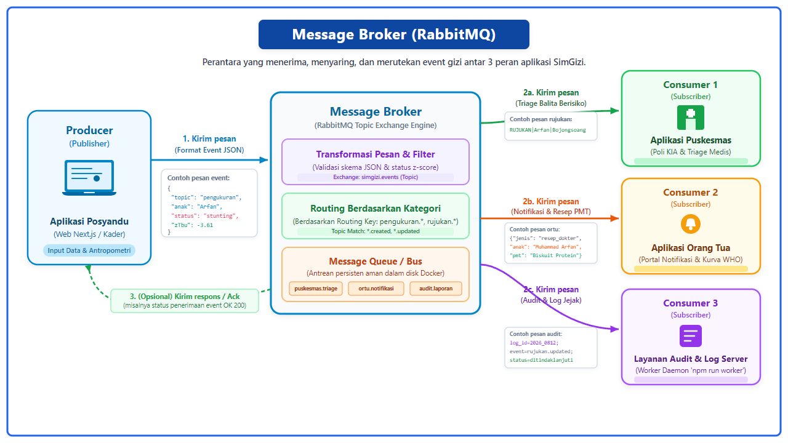
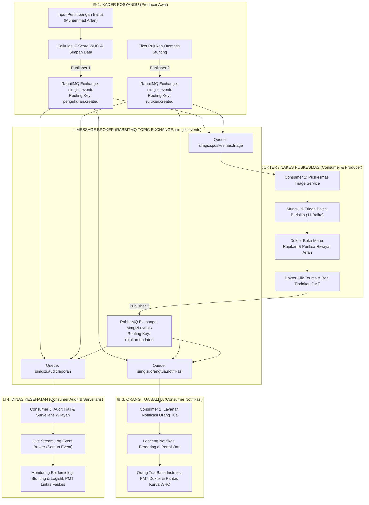

# 📘 Panduan Pengujian End-to-End & Integrasi Message Broker RabbitMQ — SimGizi

Dokumen ini adalah **panduan pengujian sistem terlengkap, terstruktur, dan satu alur berurutan (End-to-End)** dari awal hingga akhir. Panduan ini menghubungkan 4 peran pengguna (**Kader Posyandu**, **Dokter Puskesmas**, **Orang Tua Balita**, dan **Dinas Kesehatan**) dengan sistem **Message Broker RabbitMQ**.

Setiap langkah menyajikan informasi lokasi halaman, data input uji, serta titik kerja Message Broker (Exchange, Routing Key, Queue, Payload, dan Log Terminal Worker).

---

## 📑 Daftar Isi

1. [Peta Arsitektur & Titik Kerja Message Broker](#1-peta-arsitektur--titik-kerja-message-broker)
2. [Matriks Topologi RabbitMQ](#2-matriks-topologi-rabbitmq)
3. [Prasyarat Layanan](#3-prasyarat-layanan)
4. [Kredensial Akun Pengujian Resmi](#4-kredensial-akun-pengujian-resmi)
5. [Struktur Data Master Wilayah](#5-struktur-data-master-wilayah)
6. [Aturan Deduplikasi & Pencatatan Data](#6-aturan-deduplikasi--pencatatan-data)
7. [Alur Pengujian Step-by-Step](#7-alur-pengujian-step-by-step)
   - [Tahap 1: Kader Posyandu (Producer Awal)](#tahap-1-kader-posyandu-producer-awal)
   - [Tahap 2: Dokter Puskesmas (Consumer 1 & Producer Tindakan)](#tahap-2-dokter-puskesmas-consumer-1--producer-tindakan)
   - [Tahap 3: Orang Tua Balita (Consumer 2 Notifikasi)](#tahap-3-orang-tua-balita-consumer-2-notifikasi)
   - [Tahap 4: Dinas Kesehatan (Consumer 3 Audit & Surveilans)](#tahap-4-dinas-kesehatan-consumer-3-audit--surveilans)
8. [Verifikasi Teknis Message Broker](#8-verifikasi-teknis-message-broker)
9. [Checklist Keberhasilan Pengujian](#9-checklist-keberhasilan-pengujian)
10. [Cara Mengulang & Reset Data Pengujian](#10-cara-mengulang--reset-data-pengujian)

---

## 1. Peta Arsitektur & Titik Kerja Message Broker





---

## 2. Matriks Topologi RabbitMQ

Sistem SimGizi menggunakan arsitektur **Topic Exchange** dengan 3 queue konsumsi independen:

|   #   | Titik Operasi           | Event & Routing Key  | Exchange                 | Publisher (Pengirim)                            | Queues (Penerima)                                                                            | Consumer (Worker)      | Dampak Fungsional & UI                                                                                            |
| :---: | :---------------------- | :------------------- | :----------------------- | :---------------------------------------------- | :------------------------------------------------------------------------------------------- | :--------------------- | :---------------------------------------------------------------------------------------------------------------- |
| **1** | Penimbangan Balita Baru | `pengukuran.created` | `simgizi.events` (Topic) | `POST /api/pengukuran`<br>(Kader Posyandu)      | • `simgizi.puskesmas.triage`<br>• `simgizi.orangtua.notifikasi`<br>• `simgizi.audit.laporan` | **Consumer 1, 2, & 3** | Peringatan dini stunting masuk ke Puskesmas, notifikasi pertumbuhan terkirim ke Orang Tua, log diaudit di Dinkes. |
| **2** | Deteksi Balita Berisiko | `rujukan.created`    | `simgizi.events` (Topic) | `POST /api/rujukan`<br>(Posyandu / Sistem)      | • `simgizi.puskesmas.triage`<br>• `simgizi.orangtua.notifikasi`<br>• `simgizi.audit.laporan` | **Consumer 1, 2, & 3** | Tiket rujukan masuk antrean Triage Poli KIA Puskesmas, orang tua mendapat info rujukan diajukan.                  |
| **3** | Resep / Tindakan Dokter | `rujukan.updated`    | `simgizi.events` (Topic) | `PATCH /api/rujukan/[id]`<br>(Dokter Puskesmas) | • `simgizi.orangtua.notifikasi`<br>• `simgizi.audit.laporan`                                 | **Consumer 2 & 3**     | Notifikasi instruksi resep PMT & jadwal kontrol tiba di Portal Orang Tua secara real-time.                        |

---

## 3. Prasyarat Layanan

Sebelum pengujian dimulai, pastikan 3 layanan berikut menyala:

```bash
# 1. Pastikan Docker Container RabbitMQ aktif
docker ps
# Jika belum aktif:
docker compose up -d

# 2. Terminal 1: Jalankan Web Server Next.js
npm run dev

# 3. Terminal 2: Jalankan Daemon Worker Consumer RabbitMQ
npm run worker
```

> [!NOTE]
> Web server aplikasi aktif pada **[http://localhost:3000](http://localhost:3000)** dan RabbitMQ Management Console aktif pada **[http://localhost:15672](http://localhost:15672)** (User: `simgizi`, Pass: `simgizi2026`).

---

## 4. Kredensial Akun Pengujian Resmi

Seluruh peran pengguna menggunakan kata sandi tunggal yang terstandarisasi:

> **Kata Sandi (Password) Seluruh Akun**: `simgizi2026`

| Peran Pengguna       | Username                | Nama Akun / Wilayah                 | URL Halaman Utama                                                  | Peran Arsitektur                  |
| :------------------- | :---------------------- | :---------------------------------- | :----------------------------------------------------------------- | :-------------------------------- |
| **Kader Posyandu**   | `kelompok2`             | Posyandu Melati 03 (Bojongsoang)    | [http://localhost:3000/](http://localhost:3000/)                   | **Producer Awal**                 |
| **Dokter Puskesmas** | `puskesmas_bojongsoang` | Dokter Puskesmas Bojongsoang        | [http://localhost:3000/puskesmas](http://localhost:3000/puskesmas) | **Consumer 1 & Producer**         |
| **Orang Tua Balita** | `orangtua_arfan`        | Rahmat Hidayat (Ayah Arfan & Hanif) | [http://localhost:3000/orang-tua](http://localhost:3000/orang-tua) | **Consumer 2 Notifikasi**         |
| **Dinas Kesehatan**  | `dinkes_bandung`        | Dinkes Kab. Bandung                 | [http://localhost:3000/dinkes](http://localhost:3000/dinkes)       | **Consumer 3 Audit & Surveilans** |

---

## 5. Struktur Data Master Wilayah

Sistem SimGizi menerapkan struktur master data yang konsisten:

- **3 Posyandu Binaan**
- **10 Balita per Posyandu** (Total = **30 Balita**)
- **5 Orang Tua per Posyandu** (Masing-masing **2 Balita per Orang Tua**)

### A. Posyandu Melati 03 (RW 03, Bojongsoang) — 10 Balita & 5 Orang Tua

|   #   | Nama Orang Tua                        | Balita ke-1          |  Usia  | Status Gizi    | Balita ke-2        |  Usia  | Status Gizi |
| :---: | :------------------------------------ | :------------------- | :----: | :------------- | :----------------- | :----: | :---------- |
| **1** | **Rahmat Hidayat** (`orangtua_arfan`) | **Muhammad Arfan**   | 28 bln | 🟠 Stunting    | **Hanif Abdillah** | 18 bln | 🟢 Normal   |
| **2** | **Hendra Wijaya**                     | Aisyah Putri Humaira | 14 bln | 🟠 Stunting    | Siti Nurbaya       | 22 bln | 🟢 Normal   |
| **3** | **Ferry Irawan**                      | Kenzo Rafasya        | 32 bln | 🟡 Gizi Kurang | Bagas Maulana      | 16 bln | 🟢 Normal   |
| **4** | **Budi Saputra**                      | Andi Saputra         | 39 bln | 🟡 Gizi Kurang | Rania Putri        | 10 bln | 🟢 Normal   |
| **5** | **Ibrahim Hasan**                     | Dafa Ibrahim         | 12 bln | 🔴 Gizi Buruk  | Daffa Alfarizqi    | 36 bln | 🟢 Normal   |

### B. Posyandu Mekar Sari 01 (RW 01, Lengkong) — 10 Balita & 5 Orang Tua

|   #   | Nama Orang Tua      | Balita ke-1       |  Usia  | Status Gizi | Balita ke-2      |  Usia  | Status Gizi    |
| :---: | :------------------ | :---------------- | :----: | :---------- | :--------------- | :----: | :------------- |
| **1** | **Agus Setiawan**   | Zahra Amelia      | 15 bln | 🟢 Normal   | Alya Ramadhani   | 22 bln | 🟢 Normal      |
| **2** | **Taufik Hidayat**  | Fathir Ahmad      | 42 bln | 🟢 Normal   | Bintang Pratama  | 35 bln | 🟠 Stunting    |
| **3** | **Eko Prasetyo**    | Nayla Khairunnisa | 20 bln | 🟢 Normal   | Cantika Sari     | 11 bln | 🟢 Normal      |
| **4** | **Herman Ramadhan** | Rizky Ramadhan    | 30 bln | 🟢 Normal   | Dimas Ardiansyah | 40 bln | 🟡 Gizi Kurang |
| **5** | **Rizal Nur**       | Ghaida Nur        | 16 bln | 🟢 Normal   | Elsa Maharani    | 26 bln | 🟢 Normal      |

### C. Posyandu Mawar 02 (RW 02, Buahbatu) — 10 Balita & 5 Orang Tua

|   #   | Nama Orang Tua    | Balita ke-1       |  Usia  | Status Gizi   | Balita ke-2    |  Usia  | Status Gizi    |
| :---: | :---------------- | :---------------- | :----: | :------------ | :------------- | :----: | :------------- |
| **1** | **Maulana Syah**  | Farhan Maulana    | 9 bln  | 🔴 Gizi Buruk | Kevin Saputra  | 38 bln | 🟢 Normal      |
| **2** | **Agung Puspita** | Gita Puspita      | 17 bln | 🟢 Normal     | Laila Azzahra  | 21 bln | 🟢 Normal      |
| **3** | **Firmansyah**    | Haikal Firmansyah | 45 bln | 🟢 Normal     | Muhammad Raffi | 27 bln | 🟡 Gizi Kurang |
| **4** | **Rudi Permata**  | Intan Permata     | 13 bln | 🟠 Stunting   | Nadia Safitri  | 8 bln  | 🟢 Normal      |
| **5** | **Saiful Aulia**  | Jihan Aulia       | 31 bln | 🟢 Normal     | Omar Fadhilah  | 33 bln | 🟠 Stunting    |

> [!IMPORTANT]
> **Total Balita Berisiko Terintegrasi**: Tepat **11 Balita** (7 Stunting, 4 Gizi Kurang, 2 Gizi Buruk) yang otomatis masuk ke antrean **Triage Balita Berisiko Puskesmas**.

---

## 6. Aturan Deduplikasi & Pencatatan Data

Pada formulir **Pencatatan Data Anak** ([http://localhost:3000/pencatatan-anak](http://localhost:3000/pencatatan-anak)):

1. **Jika NIK Sudah Terdaftar (Contoh: `3201948392010001` - Muhammad Arfan)**:
   - Sistem mendeteksi anak telah ada di basis data.
   - Sistem **tidak membuat data anak baru**, melainkan menambahkan penimbangan terbaru sebagai entri baru pada riwayat anak tersebut.
   - Data anak di Rekap Posyandu dan Portal Orang Tua **tetap 1 dan tidak pernah duplikat**.
2. **Jika NIK Baru (Belum Terdaftar)**:
   - Sistem mendaftarkan anak sebagai data balita baru dan mengaitkannya ke orang tua sesuai nama orang tua yang diinput.

---

## 7. Alur Pengujian Step-by-Step

Pengujian dilakukan dalam satu lintasan alur berurutan yang mencakup 4 tahap:

```
[Tahap 1: Kader Posyandu] ➔ [Tahap 2: Dokter Puskesmas] ➔ [Tahap 3: Orang Tua Balita] ➔ [Tahap 4: Dinas Kesehatan]
```

---

### 🟢 TAHAP 1: KADER POSYANDU (Producer Awal)

#### Langkah 1: Login sebagai Kader Posyandu

1. Buka halaman: [http://localhost:3000/login](http://localhost:3000/login).
2. Klik tab **"Posyandu"**.
3. Masukkan kredensial:
   - **Username**: `kelompok2`
   - **Password**: `simgizi2026`
4. Klik **"Masuk ke Sistem"** ➔ Anda diarahkan ke Beranda Posyandu Melati 03.

---

#### Langkah 2: Input Penimbangan Balita Muhammad Arfan

1. Di sidebar kiri, klik menu **"Pencatatan Data Anak"** ([http://localhost:3000/pencatatan-anak](http://localhost:3000/pencatatan-anak)).
2. Isi formulir dengan data baku pengujian:
   - **Nama Balita**: `Muhammad Arfan`
   - **NIK (16 Digit)**: `3201948392010001`
   - **Nama Orang Tua**: `Rahmat Hidayat`
   - **Jenis Kelamin**: `Laki-laki`
   - **Umur (Bulan)**: `28`
   - **Berat Badan (kg)**: `10.1`
   - **Tinggi Badan (cm)**: `78.5`
   - **Alamat**: `Jl. Sukabirus No. 14, RT 02/03`
3. Klik tombol hijau **"Tambah data balita"**.
4. **Hasil pada UI**:
   - Toast notifikasi sukses: _"Data Balita berhasil ditambahkan"_.
   - Z-Score WHO Permenkes 2020 terhitung: **TB/U = `-3.61 SD`** (Status: **`Stunting`**).

> [!IMPORTANT]
> **Aktivitas Titik Message Broker #1 & #2 (API: POST `/api/pengukuran`)**:
>
> - **Event 1**: `pengukuran.created` diterbitkan ke Topic Exchange `simgizi.events` (Routing Key: `pengukuran.created`).
> - **Event 2**: Karena anak terdeteksi Stunting, tiket rujukan dibuat otomatis dan event `rujukan.created` diterbitkan ke `simgizi.events`.
> - **Log Terminal Worker (`npm run worker`)**:
>   ```text
>   [Consumer 1 - Puskesmas Triage] Menerima event pengukuran.created:
>     -> [Peringatan Dini Epidemiologi] Kasus STUNTING: Muhammad Arfan (TB/U: -3.61 SD)
>   [Consumer 2 - Notifikasi Orang Tua] Menerima event pengukuran.created:
>     -> [Pesan Orang Tua] Notifikasi pertumbuhan dikirim untuk Muhammad Arfan: BB 10.1 kg, TB 78.5 cm (stunting)
>   [Consumer 1 - Puskesmas Triage] Menerima event rujukan.created:
>     -> [Triage Medis] Pasien: Muhammad Arfan | Status: diajukan
>   [Consumer 3 - Audit Dinkes] Event tercatat: pengukuran.created & rujukan.created
>   ```

---

#### Langkah 3: Verifikasi Deduplikasi di Rekap Posyandu

1. Di sidebar kiri, buka menu **"Rekap Data Gizi"** ([http://localhost:3000/rekap-data-gizi](http://localhost:3000/rekap-data-gizi)).
2. Periksa baris **Muhammad Arfan**:
   - Nama hanya tampil **1 baris** (bebas duplikasi).
   - Nilai Z-Score TB/U menampilkan status terbarukan: **`-3.61 SD`** (Badge Stunting).

---

#### Langkah 4: Periksa Status Tiket Rujukan di Posyandu

1. Di sidebar kiri, klik menu **"Rujukan"** ([http://localhost:3000/rujukan](http://localhost:3000/rujukan)).
2. Tiket rujukan **Muhammad Arfan** berstatus **`Diajukan`** ke Puskesmas Bojongsoang.
3. Klik tombol **Logout** (Ikon keluar di bilah kiri bawah).

---

### 🔵 TAHAP 2: DOKTER PUSKESMAS (Consumer 1 & Producer Tindakan)

#### Langkah 5: Login sebagai Dokter Puskesmas

1. Buka halaman: [http://localhost:3000/login](http://localhost:3000/login).
2. Klik tab **"Puskesmas"**.
3. Masukkan kredensial:
   - **Username**: `puskesmas_bojongsoang`
   - **Password**: `simgizi2026`
4. Klik **"Masuk ke Sistem"** ➔ Masuk ke Dashboard Puskesmas Bojongsoang ([http://localhost:3000/puskesmas](http://localhost:3000/puskesmas)).

---

#### Langkah 6: Periksa Triage Balita Berisiko

1. Di sidebar kiri, klik menu **"Balita Berisiko"** ([http://localhost:3000/puskesmas/balita-berisiko](http://localhost:3000/puskesmas/balita-berisiko)).
2. Periksa daftar triage:
   - Menampilkan **seluruh 11 balita berisiko** dari 3 posyandu binaan:
     - 🔴 **Prioritas 1 (Gizi Buruk)**: _Dafa Ibrahim, Farhan Maulana_
     - 🟠 **Prioritas 2 (Stunting)**: _Muhammad Arfan, Aisyah Putri Humaira, Bintang Pratama, Intan Permata, Omar Fadhilah_
     - 🟡 **Prioritas 3 (Gizi Kurang)**: _Kenzo Rafasya, Andi Saputra, Dimas Ardiansyah, Muhammad Raffi_
   - Kartu Muhammad Arfan tampil bersih di Prioritas 2 tanpa kartu ganda.

---

#### Langkah 7: Periksa Riwayat Pengukuran Antropometri

1. Pada baris **Muhammad Arfan**, klik tombol **"Detail"** (URL: `/anak/d0000000-0000-0000-0000-000000000001`).
2. Perhatikan tabel **"Riwayat Pengukuran Antropometri"**:
   - **Baris 1 (Pemeriksaan Terbaru)**: Usia 28 bln, BB 10.1 kg, TB 78.5 cm, TB/U: -3.61 SD (Stunting)
   - **Baris 2 (Pemeriksaan Sebelumnya)**: Usia 28 bln, BB 10.1 kg, TB 78.5 cm, TB/U: -3.10 SD
3. Klik tombol **"Kembali"**.

---

#### Langkah 8: Dokter Menerima Rujukan & Memberi Resep PMT

1. Di sidebar kiri, klik menu **"Rujukan"** ([http://localhost:3000/puskesmas/rujukan](http://localhost:3000/puskesmas/rujukan)).
2. Temukan rujukan pasien **Muhammad Arfan**:
   - Klik tombol **"Terima"** ➔ Status berubah menjadi **`Diterima`**.
   - Klik tombol **"Tindak Lanjut"** ➔ Modal tindakan medis terbuka.
3. Masukkan catatan tindakan dokter:
   > _"Pemeriksaan poli KIA Puskesmas selesai. Diberikan paket PMT Pemulihan biskuit protein hewani, suplementasi zat besi & vitamin A. Edukasi sanitasi air bersih serta jadwalkan kontrol ulang 14 hari ke depan."_
4. Klik **"Simpan Tindakan"** ➔ Status rujukan berubah menjadi **`Ditindaklanjuti`**.

> [!IMPORTANT]
> **Aktivitas Titik Message Broker #3 (API: PATCH `/api/rujukan/[id]`)**:
>
> - **Event 3**: `rujukan.updated` diterbitkan ke Topic Exchange `simgizi.events` (Routing Key: `rujukan.updated`).
> - **Diterima di**: Queue `simgizi.orangtua.notifikasi` dan `simgizi.audit.laporan`.
> - **Log Terminal Worker (`npm run worker`)**:
>   ```text
>   [Consumer 2 - Notifikasi Orang Tua] Menerima event rujukan.updated:
>     -> [Pesan Orang Tua] Status rujukan Muhammad Arfan diperbarui menjadi: DITINDAKLANJUTI
>   [Consumer 3 - Audit Dinkes] Event: rujukan.updated | Producer: puskesmas
>   ```

5. Klik tombol **Logout**.

---

### 🟣 TAHAP 3: ORANG TUA BALITA (Consumer 2 Notifikasi)

#### Langkah 9: Login sebagai Orang Tua Arfan

1. Buka halaman: [http://localhost:3000/login](http://localhost:3000/login).
2. Klik tab **"Orang Tua"**.
3. Masukkan kredensial:
   - **Username**: `orangtua_arfan`
   - **Password**: `simgizi2026`
4. Klik **"Masuk ke Sistem"** ➔ Beranda Portal Orang Tua ([http://localhost:3000/orang-tua](http://localhost:3000/orang-tua)).
5. **Hasil pada UI**:
   - Pemilih anak hanya memuat **tepat 2 anak** milik Rahmat Hidayat:
     - 🟢 **Muhammad Arfan** (Anak ke-1)
     - ⚪ **Hanif Abdillah** (Anak ke-2)
   - Kartu utama memuat instruksi dokter:
     - **"Rujukan Ditindaklanjuti Dokter Puskesmas"**
     - Catatan: _"Pemeriksaan poli KIA Puskesmas selesai. Diberikan paket PMT Pemulihan biskuit protein hewani..."_

---

#### Langkah 10: Periksa Notifikasi Real-Time

1. Klik ikon **Lonceng (Pemberitahuan)** pada Topbar atau buka [http://localhost:3000/orang-tua/notifikasi](http://localhost:3000/orang-tua/notifikasi).
2. Notifikasi resep dokter tampil secara langsung:
   - 🩺 **Rujukan Ditindaklanjuti Dokter Puskesmas**
   - Catatan resep PMT dan jadwal kontrol tampil lengkap dengan badge belum dibaca.
3. Klik tombol **"Tandai Sudah Dibaca"**.

---

#### Langkah 11: Pantau Kurva Standar WHO Kemenkes 2020

1. Di sidebar kiri, klik menu **"Perkembangan"** ([http://localhost:3000/orang-tua/perkembangan](http://localhost:3000/orang-tua/perkembangan)).
2. **Hasil pada UI**:
   - Grafik interaktif kurva WHO (Pita Median, -2 SD, -3 SD) aktif 100%.
   - Titik riil penimbangan Arfan terplot tepat pada grafik TB/U (78.5 cm usia 28 bulan) dan BB/U (10.1 kg).
   - Metrik antropometri menampilkan Z-Score resmi Permenkes 2020:
     - TB/U: `-3.61 SD` (Stunting)
     - BB/U: `-1.87 SD` (Normal / Borderline)
3. Klik tombol **Logout**.

---

### 🏢 TAHAP 4: DINAS KESEHATAN (Consumer 3 Audit & Surveilans)

#### Langkah 12: Login sebagai Dinas Kesehatan

1. Buka halaman: [http://localhost:3000/login](http://localhost:3000/login).
2. Klik tab **"Dinas Kesehatan"**.
3. Masukkan kredensial:
   - **Username**: `dinkes_bandung`
   - **Password**: `simgizi2026`
4. Klik **"Masuk ke Sistem"** ➔ Masuk ke Dashboard Dinas Kesehatan ([http://localhost:3000/dinkes](http://localhost:3000/dinkes)).

---

#### Langkah 13: Pantau Surveilans Epidemiologi Wilayah

1. Di halaman [http://localhost:3000/dinkes](http://localhost:3000/dinkes):
2. **Hasil pada UI**:
   - **Kartu Metrik Wilayah**:
     - Total Balita: `30 Balita`
     - Status Normal: `17 Balita`
     - Balita Berisiko: `13 Balita` (7 Stunting, 4 Gizi Kurang, 2 Gizi Buruk)
     - Faskes Aktif: `3 Posyandu, 1 Puskesmas`
   - **Distribusi Status Gizi WHO**:
     - Visualisasi progress bar proporsi Permenkes 2020.
   - **Pemetaan Zona Risiko Posyandu Binaan**:
     - Posyandu Melati 03 (3 Kasus Stunting — Zona Merah)
     - Posyandu Mawar 01 (2 Kasus Stunting — Zona Kuning)
     - Posyandu Anggrek 02 (2 Kasus Stunting — Zona Kuning)
   - **Feed Event Broker Terkini**:
     - Menampilkan 4 aktivitas RabbitMQ terbaru secara live di bagian bawah dashboard.

---

#### Langkah 14: Verifikasi Log Riwayat & Sinkronisasi Data (Consumer 3)

1. Di sidebar kiri, klik menu **"Riwayat Aktivitas Data"** ([http://localhost:3000/dinkes/audit-log](http://localhost:3000/dinkes/audit-log)).
2. **Hasil pada UI**:
   - **Badge Identitas**: `Dinas Kesehatan Kab. Bandung • Jalur Pengawasan Terpadu`.
   - **Status Integrasi**: `Terhubung Otomatis` (Layanan Pengawasan Siaga Real-Time).
   - **Tabel Log Riwayat Aktivitas**:
     - Aktivitas **Penimbangan Balita** (`pengukuran.created`) dari Kader Posyandu.
     - Aktivitas **Pengajuan Rujukan** (`rujukan.created`) saat rujukan stunting dibuat.
     - Aktivitas **Tindakan Puskesmas** (`rujukan.updated`) saat Dokter Puskesmas memberikan penanganan.
     - Status Pengiriman: Badge hijau **Tersinkronisasi**.
   - **Inspeksi Rincian Informasi**:
     - Klik tombol **"Lihat Detail"** pada baris aktivitas.
     - Menampilkan kartu rincian yang rapi dan mudah dipahami: data balita, instansi/faskes pengirim, waktu pemeriksaan lengkap, hasil pengukuran (BB, TB, Z-Score), serta catatan/tindakan dokter dan resep bantuan PMT.

---

#### Langkah 15: Pemantauan Logistik PMT & Fasilitas Kesehatan

1. Di sidebar kiri, klik menu **"Logistik PMT"** ([http://localhost:3000/dinkes/logistik](http://localhost:3000/dinkes/logistik)):
   - Memantau ketersediaan stok paket PMT Pemulihan, biskuit protein hewani, dan susu pertumbuhan.
   - Melihat riwayat distribusi bantuan gizi ke Puskesmas dan Posyandu.
2. Di sidebar kiri, klik menu **"Fasilitas Kesehatan"** ([http://localhost:3000/dinkes/faskes](http://localhost:3000/dinkes/faskes)):
   - Memantau profil 3 Posyandu binaan, jumlah kader aktif, jadwal penimbangan, dan rata-rata SLA penanganan rujukan stunting.

---

## 8. Verifikasi Teknis Message Broker

Bagi penguji teknis yang ingin membuktikan integritas antrean RabbitMQ secara independen:

### 1. Cek Healthcheck API Broker

Jalankan perintah berikut pada terminal:

```bash
curl http://localhost:3000/api/broker/status
```

**Respon JSON**:

```json
{
  "connected": true,
  "exchange": "simgizi.events",
  "queues": {
    "puskesmas": {
      "name": "simgizi.puskesmas.triage",
      "messageCount": 0,
      "consumerCount": 1
    },
    "orangtua": {
      "name": "simgizi.orangtua.notifikasi",
      "messageCount": 0,
      "consumerCount": 1
    },
    "audit": {
      "name": "simgizi.audit.laporan",
      "messageCount": 0,
      "consumerCount": 1
    }
  },
  "message": "RabbitMQ Message Broker aktif & siap menyalurkan event."
}
```

### 2. Cek RabbitMQ Management UI

1. Buka browser: [http://localhost:15672](http://localhost:15672)
2. Login:
   - **Username**: `simgizi`
   - **Password**: `simgizi2026`
3. Tab **"Exchanges"**: Periksa Topic Exchange `simgizi.events`.
4. Tab **"Queues"**: Pastikan ketiga queue memiliki `Consumer Count = 1` (worker daemon terhubung aktif).

---

## 9. Checklist Keberhasilan Pengujian

- [x] **Deduplikasi Bersih**: Daftar Rekap Balita unik per-NIK (Muhammad Arfan hanya muncul 1 baris).
- [x] **Rincian Akumulatif**: Penimbangan baru tercatat sebagai riwayat di detail anak (`/anak/[id]`).
- [x] **Triage Medis Lengkap**: Seluruh 11 balita berisiko terpetakan ke antrean Triage Puskesmas.
- [x] **Event-Driven Broker**: Event `pengukuran.created`, `rujukan.created`, dan `rujukan.updated` terdistribusi ke 3 Consumer RabbitMQ.
- [x] **Portal Orang Tua**: Notifikasi resep dokter dan kurva tumbuh kembang WHO Kemenkes 2020 tampil transparan bagi keluarga balita.
- [x] **Dashboard Dinas Kesehatan**: Surveilans wilayah, audit trail message broker (Consumer 3), dan monitoring PMT beroperasi 100%.

---

## 10. Cara Mengulang & Reset Data Pengujian

Bagi penguji yang melakukan testing berulang kali, berikut cara kerja dan opsi reset data:

### A. Aman Diuji Berulang Kali (Tanpa Perlu Reset)
- Jika Anda menginput NIK yang sama (misal `3201948392010001` milik Muhammad Arfan), sistem **tidak akan menduplikasi** data anak di Rekap Posyandu maupun di Akun Orang Tua.
- Sistem mencatatnya sebagai penimbangan berkala baru dan **tetap menerbitkan event RabbitMQ** (`pengukuran.created` dan `rujukan.created`) setiap kali Anda mengklik simpan.
- Anda bebas menguji klik submit berulang kali untuk melihat aliran pesan di Terminal Worker dan Audit Trail Dinkes.

### B. Opsi Reset Bersih Total (Kembali ke 30 Balita Baku Awal)

Jika Anda ingin mengosongkan riwayat uji coba dan mengembalikan sistem ke kondisi awal 100%:

1. **Reset Database Server**:
   Buka URL berikut di browser atau jalankan perintah:
   ```bash
   curl http://localhost:3000/api/reset-data
   ```
   Tautan Browser: **[http://localhost:3000/api/reset-data](http://localhost:3000/api/reset-data)**

2. **Bersihkan Cache Browser (LocalStorage)**:
   - Tekan tombol `F12` di browser untuk membuka Developer Tools.
   - Buka tab **Console**, lalu ketik:
     ```javascript
     localStorage.clear(); location.reload();
     ```
   - Halaman akan memuat ulang dengan data 30 balita baku awal yang bersih.
