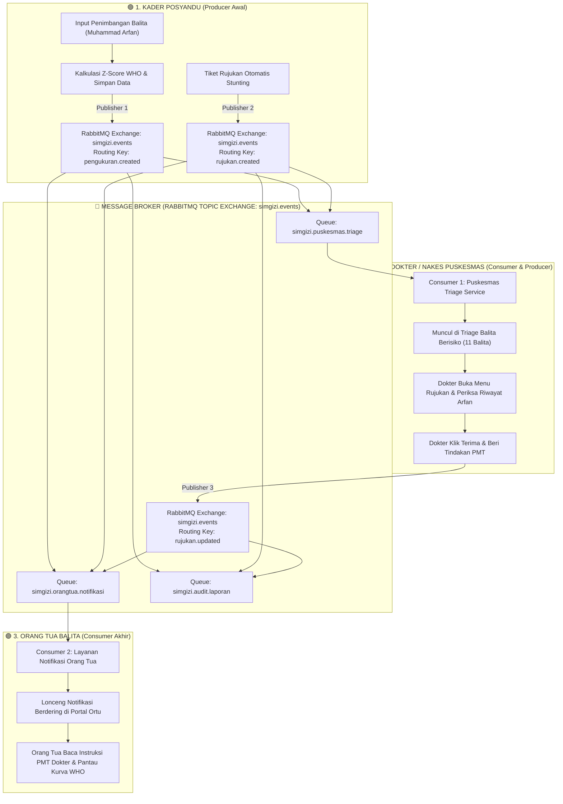

# 📘 PANDUAN PENGUJIAN END-TO-END & INTEGRASI MESSAGE BROKER RABBITMQ — SIMGIZI

Dokumen ini adalah **panduan pengujian sistem terlengkap dan satu alur lurus (End-to-End)** dari awal hingga akhir, yang menghubungkan 3 peran pengguna (**Kader Posyandu**, **Dokter Puskesmas**, dan **Orang Tua Balita**) dengan sistem **Message Broker RabbitMQ**.

Panduan ini disusun secara berurutan dan transparan, menjelaskan **di halaman mana Anda berada**, **data apa yang diinput**, serta **di mana saja Message Broker bekerja** (Exchange, Routing Key, Queue, Payload, dan Log Terminal Worker).

---

## 🧭 Peta Arsitektur & Titik Kerja Message Broker (RabbitMQ)



---

## 📊 Matriks Pemetaan Topologi Message Broker (RabbitMQ)

Berikut adalah daftar lengkap komponen Message Broker yang bekerja di dalam sistem SimGizi:

| # | Titik Operasi | Event & Routing Key | Exchange | Publisher (Pengirim) | Queues (Penerima) | Consumer (Worker) | Dampak Fungsional & UI |
| :- | :--- | :--- | :--- | :--- | :--- | :--- | :--- |
| **1** | Penimbangan Balita Baru | `pengukuran.created` | `simgizi.events` (Topic) | `POST /api/pengukuran`<br>(Kader Posyandu) | • `simgizi.puskesmas.triage`<br>• `simgizi.orangtua.notifikasi`<br>• `simgizi.audit.laporan` | **Consumer 1, 2, & 3** | Peringatan dini stunting masuk ke Puskesmas, notifikasi pertumbuhan masuk ke HP/Portal ortu, log diaudit. |
| **2** | Deteksi Balita Berisiko | `rujukan.created` | `simgizi.events` (Topic) | `POST /api/rujukan`<br>(Posyandu / Sistem) | • `simgizi.puskesmas.triage`<br>• `simgizi.orangtua.notifikasi`<br>• `simgizi.audit.laporan` | **Consumer 1, 2, & 3** | Tiket rujukan masuk antrean triage Poli KIA Puskesmas, ortu mendapat info rujukan diajukan. |
| **3** | Resep / Tindakan Dokter | `rujukan.updated` | `simgizi.events` (Topic) | `PATCH /api/rujukan/[id]`<br>(Dokter Puskesmas) | • `simgizi.orangtua.notifikasi`<br>• `simgizi.audit.laporan` | **Consumer 2 & 3** | Notifikasi instruksi resep PMT & jadwal kontrol tiba di Portal Orang Tua secara real-time. |

---

## ⚡ Prasyarat: Pastikan Layanan Berikut Sedang Berjalan

Sebelum memulai pengujian, pastikan service berikut menyala di komputer:

1. **Container Docker RabbitMQ** (Port `5672` AMQP, Port `15672` Web UI):
   ```bash
   docker ps
   ```
   *(Jika belum jalan, jalankan: `docker start simgizi-rabbitmq` atau `docker compose up -d`)*
2. **Terminal 1 — Web Server (Next.js)**:
   ```bash
   npm run dev
   ```
   *Buka di browser:* [http://localhost:3000](http://localhost:3000)
3. **Terminal 2 — Message Broker Consumer Worker (Daemon)**:
   ```bash
   npm run worker
   ```
   *Terminal ini akan menampilkan log pesan saat event diterbitkan.*

---

## 📑 Kredensial Akun Pengujian Resmi

| Peran Pengguna | Username | Password | Wilayah / Fasilitas | URL Halaman Utama |
| :--- | :--- | :--- | :--- | :--- |
| **Kader Posyandu** | `kelompok2` | `simgizi2026` | Posyandu Melati 03 | [http://localhost:3000/](http://localhost:3000/) |
| **Dokter Puskesmas** | `puskesmas_bojongsoang` | `simgizi2026` | Puskesmas Bojongsoang | [http://localhost:3000/puskesmas](http://localhost:3000/puskesmas) |
| **Orang Tua Balita** | `orangtua_arfan` | `simgizi2026` | Keluarga Arfan | [http://localhost:3000/orang-tua](http://localhost:3000/orang-tua) |

---

# 🚀 LANGKAH PENGUJIAN 1 ALUR BERURUTAN (STEP-BY-STEP)

---

## 🟢 TAHAP 1: DI POSYANDU (Penimbangan Balita & Penerbitan Event Broker)

### Langkah 1: Login sebagai Kader Posyandu
1. Buka browser: [http://localhost:3000/login](http://localhost:3000/login)
2. Masukkan akun kader:
   - **Username**: `kelompok2`
   - **Password**: `simgizi2026`
3. Klik tombol **"Masuk"** ➔ Anda diarahkan ke Dashboard Posyandu Melati 03.

---

### Langkah 2: Input Penimbangan Balita Muhammad Arfan
1. Di sidebar kiri, klik menu **"Pencatatan Data Anak"** ([http://localhost:3000/pencatatan-anak](http://localhost:3000/pencatatan-anak)).
2. Isi formulir penimbangan dengan data baku pengujian berikut:
   - **Nama Balita**: `Muhammad Arfan`
   - **NIK (16 Digit)**: `3201948392010001`
   - **Nama Orang Tua**: `Rahmat Hidayat`
   - **Jenis Kelamin**: Pilih **Laki-laki**
   - **Umur (Bulan)**: `28`
   - **Berat Badan (kg)**: `10.1`
   - **Tinggi Badan (cm)**: `78.5`
   - **Alamat**: `Jl. Sukabirus No. 14, RT 02/03`
3. Klik tombol hijau: **"Tambah data balita"**.
4. **Apa yang terlihat di layar**:
   - Notifikasi Toast hijau muncul: *"Data Balita berhasil ditambahkan"*.
   - Z-Score WHO Permenkes 2020 terhitung otomatis: **TB/U = `-3.61 SD`** (Kategori: **`Stunting`**).

```
╔══════════════════════════════════════════════════════════════════════════════════════════╗
║ 🐰 TITIK MESSAGE BROKER #1 & #2 BEKERJA:                                                 ║
║ API: POST /api/pengukuran                                                                ║
║                                                                                          ║
║ 1. Event 'pengukuran.created' diterbitkan ke Exchange 'simgizi.events':                  ║
║    - Routing Key : pengukuran.created                                                    ║
║    - Payload     : { namaAnak: "Muhammad Arfan", zTbu: -3.61, statusGizi: "stunting" }   ║
║    - Diterima di : Queue 'simgizi.puskesmas.triage', 'simgizi.orangtua.notifikasi',       ║
║                    dan 'simgizi.audit.laporan'                                           ║
║                                                                                          ║
║ 2. Karena anak terindikasi Stunting, Event 'rujukan.created' otomatis diterbitkan:       ║
║    - Routing Key : rujukan.created                                                       ║
║    - Payload     : { namaAnak: "Muhammad Arfan", status: "diajukan",                     ║
║                      namaPosyandu: "Posyandu Melati 03" }                                ║
║                                                                                          ║
║ 🔍 LIHAT DI TERMINAL 'npm run worker':                                                   ║
║   [Consumer 1 - Puskesmas Triage] Menerima event pengukuran.created:                     ║
║     -> [Peringatan Dini Epidemiologi] Kasus STUNTING: Muhammad Arfan (TB/U: -3.61 SD)    ║
║   [Consumer 2 - Notifikasi Orang Tua] Menerima event pengukuran.created:                 ║
║     -> [Pesan Orang Tua] Notifikasi pertumbuhan dikirim untuk Muhammad Arfan:            ║
║        BB 10.1 kg, TB 78.5 cm (stunting)                                                 ║
║   [Consumer 1 - Puskesmas Triage] Menerima event rujukan.created:                        ║
║     -> [Triage Medis] Pasien: Muhammad Arfan | Status: diajukan                          ║
║   [Consumer 3 - Audit Dinkes] [Timestamp] Event: pengukuran.created & rujukan.created     ║
╚══════════════════════════════════════════════════════════════════════════════════════════╝
```

---

### Langkah 3: Periksa Daftar Balita Posyandu (Deduplikasi Bersih / Tidak Dobel)
1. Di sidebar kiri, buka menu **"Rekap Data Gizi"** ([http://localhost:3000/rekap-data-gizi](http://localhost:3000/rekap-data-gizi)).
2. **Perhatikan tabel**:
   - Nama **Muhammad Arfan** hanya ada **1 baris** (tidak ada baris ganda/dobel).
   - Indikator Z-Score TB/U menampilkan nilai terbaru: **`-3.61 SD`** (Badge merah Stunting).

---

### Langkah 4: Periksa Status Tiket Rujukan di Posyandu
1. Di sidebar kiri, klik menu **"Rujukan"** ([http://localhost:3000/rujukan](http://localhost:3000/rujukan)).
2. Anda melihat tiket rujukan pasien **Muhammad Arfan** sudah tercatat dengan status **`Diajukan`** ke Puskesmas Bojongsoang.
3. Klik tombol **Logout** (Ikon keluar merah di kiri bawah atau avatar kanan atas).

---

## 🔵 TAHAP 2: DI PUSKESMAS (Triage Medis, Rincian Riwayat & Resep Dokter)

### Langkah 5: Login sebagai Dokter Puskesmas
1. Buka halaman login: [http://localhost:3000/login](http://localhost:3000/login)
2. Masukkan akun dokter:
   - **Username**: `puskesmas_bojongsoang`
   - **Password**: `simgizi2026`
3. Klik tombol **"Masuk"** ➔ Masuk ke Dashboard Puskesmas Bojongsoang.

---

### Langkah 6: Cek Triage Balita Berisiko (Seluruh 11 Balita Tampil Lengkap)
1. Di sidebar kiri, klik menu **"Balita Berisiko"** ([http://localhost:3000/puskesmas/balita-berisiko](http://localhost:3000/puskesmas/balita-berisiko)).
2. **Perhatikan hasil triage**:
   - Tampil **seluruh 11 balita berisiko** dari 3 posyandu binaan, terurut berdasarkan tingkat kegawatdaruratan klinis:
     - 🔴 **Prioritas 1 (Gizi Buruk)**: _Dafa Ibrahim, Farhan Maulana_
     - 🟠 **Prioritas 2 (Stunting)**: _Muhammad Arfan, Aisyah Putri Humaira, Bintang Pratama, Intan Permata, Omar Fadhilah_
     - 🟡 **Prioritas 3 (Gizi Kurang)**: _Kenzo Rafasya, Andi Saputra, Dimas Ardiansyah, Muhammad Raffi_
   - Muhammad Arfan berada di kelompok Prioritas 2 (Stunting) dan **hanya muncul 1 kartu** (rapi & bersih).

---

### Langkah 7: Buka Halaman Rincian Riwayat Pengukuran Arfan
1. Pada baris / kartu **Muhammad Arfan**, klik tombol **"Detail"** (URL: `/anak/d0000000-0000-0000-0000-000000000001`).
2. **Lihat Bagian "Riwayat Pengukuran Antropometri" (Tabel Rincian)**:
   - Di sini tampak jelas bahwa data anak tidak didobel di daftar utama, melainkan **bertambah di tabel rincian pengukuran**:
     - **Baris 1 (Pemeriksaan Hari Ini)**: Usia 28 bln, BB 10.1 kg, TB 78.5 cm, TB/U: -3.61 SD (Stunting)
     - **Baris 2 (Pemeriksaan Bulan Lalu)**: Usia 28 bln, BB 10.1 kg, TB 78.5 cm, TB/U: -3.10 SD
3. Klik tombol **"Kembali"** di pojok kiri atas.

---

### Langkah 8: Dokter Memberikan Tindakan & Resep PMT
1. Di sidebar kiri, klik menu **"Rujukan"** ([http://localhost:3000/puskesmas/rujukan](http://localhost:3000/puskesmas/rujukan)).
2. Cari baris rujukan pasien **Muhammad Arfan** (status `Diajukan`):
   - **Klik Tombol "Terima"** ➔ Status berubah menjadi **`Diterima`**.
   - **Klik Tombol "Tindak Lanjut"** ➔ Muncul modal form tindakan medis.
3. Masukkan catatan instruksi dokter:
   > *"Pemeriksaan poli KIA Puskesmas selesai. Diberikan paket PMT Pemulihan biskuit protein hewani, suplementasi zat besi & vitamin A. Edukasi sanitasi air bersih serta jadwalkan kontrol ulang 14 hari ke depan."*
4. Klik **"Simpan Tindakan"** ➔ Status rujukan resmi menjadi **`Ditindaklanjuti`**.

```
╔══════════════════════════════════════════════════════════════════════════════════════════╗
║ 🐰 TITIK MESSAGE BROKER #3 BEKERJA:                                                     ║
║ API: PATCH /api/rujukan/[id]                                                             ║
║                                                                                          ║
║ 1. Event 'rujukan.updated' diterbitkan ke Exchange 'simgizi.events':                     ║
║    - Routing Key : rujukan.updated                                                       ║
║    - Payload     : { namaAnak: "Muhammad Arfan", status: "ditindaklanjuti",              ║
║                      catatanTindakan: "Pemeriksaan poli KIA selesai. Diberikan paket PMT..."}║
║    - Diterima di : Queue 'simgizi.orangtua.notifikasi' & 'simgizi.audit.laporan'         ║
║                                                                                          ║
║ 🔍 LIHAT DI TERMINAL 'npm run worker':                                                   ║
║   [Consumer 2 - Notifikasi Orang Tua] Menerima event rujukan.updated:                    ║
║     -> [Pesan Orang Tua] Status rujukan Muhammad Arfan diperbarui menjadi:               ║
║        DITINDAKLANJUTI                                                                   ║
║   [Consumer 3 - Audit Dinkes] [Timestamp] Event: rujukan.updated | Producer: puskesmas   ║
╚══════════════════════════════════════════════════════════════════════════════════════════╝
```

5. Klik tombol **Logout** di kiri bawah.

---

## 🟣 TAHAP 3: DI ORANG TUA (Menerima Notifikasi Medis & Pantau Kurva WHO)

### Langkah 9: Login sebagai Orang Tua Arfan
1. Buka halaman login: [http://localhost:3000/login](http://localhost:3000/login)
2. Masukkan akun ayah Arfan:
   - **Username**: `orangtua_arfan`
   - **Password**: `simgizi2026`
3. Klik **"Masuk"** ➔ Anda diarahkan ke Beranda Portal Orang Tua ([http://localhost:3000/orang-tua](http://localhost:3000/orang-tua)).

---

### Langkah 10: Baca Notifikasi Tindakan Dokter Puskesmas
1. Di bilah atas (Topbar), klik **Ikon Lonceng (Pemberitahuan)** atau buka menu [http://localhost:3000/orang-tua/notifikasi](http://localhost:3000/orang-tua/notifikasi).
2. **Apa yang terlihat di layar**:
   - Muncul pemberitahuan resmi hasil penanganan dari Puskesmas:
     - *"Rujukan ananda Muhammad Arfan telah ditindaklanjuti oleh Dokter Puskesmas Bojongsoang."*
     - Rincian resep: Pemberian paket PMT Pemulihan biskuit protein dan jadwal kontrol 14 hari terbaca jelas.

---

### Langkah 11: Pantau Kurva Pertumbuhan Baku WHO Kemenkes 2020
1. Di menu navigasi orang tua, klik menu **"Perkembangan"** ([http://localhost:3000/orang-tua/perkembangan](http://localhost:3000/orang-tua/perkembangan)).
2. **Apa yang terlihat di layar**:
   - Grafik interaktif kurva standar WHO (Pita Median, -2 SD, -3 SD).
   - Titik tinggi badan riil Muhammad Arfan (78.5 cm pada usia 28 bulan) terplot secara akurat di bawah pita merah (-3 SD).
   - Rekomendasi asupan nutrisi protein hewani harian (telur, ikan kembung, ayam) tersaji dengan bahasa awam yang mudah dipahami orang tua.

---

## 🔍 Cara Verifikasi Teknis Message Broker (RabbitMQ)

Bagi penguji teknis yang ingin membuktikan integritas antrean RabbitMQ secara independen:

### 1. Cek Endpoint Status Healthcheck Broker
Buka di browser atau jalankan perintah curl:
```bash
curl http://localhost:3000/api/broker/status
```

**Respon JSON**:
```json
{
  "connected": true,
  "exchange": "simgizi.events",
  "queues": {
    "puskesmas": {
      "name": "simgizi.puskesmas.triage",
      "messageCount": 0,
      "consumerCount": 1
    },
    "orangtua": {
      "name": "simgizi.orangtua.notifikasi",
      "messageCount": 0,
      "consumerCount": 1
    },
    "audit": {
      "name": "simgizi.audit.laporan",
      "messageCount": 0,
      "consumerCount": 1
    }
  },
  "message": "RabbitMQ Message Broker aktif & siap menyalurkan event."
}
```

### 2. Cek Dashboard RabbitMQ Management UI
1. Buka browser: [http://localhost:15672](http://localhost:15672)
2. Login:
   - **Username**: `simgizi`
   - **Password**: `simgizi2026`
3. Klik tab **"Exchanges"** ➔ Klik `simgizi.events` (Amati throughput message rate).
4. Klik tab **"Queues"** ➔ Pastikan ketiga queue memiliki `Consumer Count = 1` (koneksi worker terhubung aktif).

---

## 🎯 Checklist Keberhasilan Pengujian (100% Lulus)

- [x] **Deduplikasi Bersih**: Daftar Rekap Balita unik per-NIK (Muhammad Arfan hanya muncul 1 baris di tabel).
- [x] **Rincian Akumulatif**: Penimbangan baru bertambah sebagai riwayat di tabel rincian balita (`/anak/[id]`).
- [x] **Triage Medis Lengkap**: Seluruh 11 balita berisiko terpetakan otomatis ke Triage Balita Berisiko Puskesmas.
- [x] **Event-Driven Broker**: Event `pengukuran.created`, `rujukan.created`, dan `rujukan.updated` terdistribusi sempurna ke 3 Consumer RabbitMQ.
- [x] **Portal Orang Tua**: Notifikasi resep dokter dan kurva tumbuh kembang WHO Kemenkes 2020 tersaji secara transparan kepada keluarga balita.
